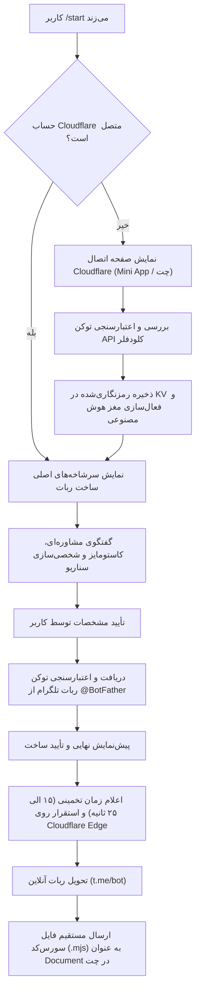

# ⚡️ ®️SHΞN robotic™ — Botmother Studio

> **معمار و استودیوی هوشمند ساخت، شخصی‌سازی و استقرار سرورلس ربات‌های تلگرام بر روی لبه ابری Cloudflare Workers**

[](https://workers.cloudflare.com/)
[](https://core.telegram.org/bots/api)
[](https://developers.cloudflare.com/workers-ai/)
[](https://opensource.org/licenses/MIT)

---

## 🌟 معرفی پروژه

پروژه **Botmother** یک موتور نسل جدید برای ایجاد و استقرار ربات‌های تلگرام است. این پلتفرم نیاز به هرگونه سرور سنتی، VPS، قطعی یا پیکربندی‌های پیچیده را برطرف کرده و تمام پردازش‌ها را روی شبکه جهانی لبه **Cloudflare Workers** (به همراه هوش مصنوعی Workers AI و دیتابیس KV) اجرا می‌نماید.

---

## ✨ ویژگی‌های برجسته

- 🧠 **معمار هوشمند هوش مصنوعی (AI Consultant):** تحلیل نیاز کاربر، پیشنهاد امکانات و مشاوره قبل از ساخت.
- ☁️ **اتصال ابری در گام اول (Cloudflare-First):** تامین منابع محاسباتی، امنیت و پایداری بر روی اکانت اختصاصی کاربر.
- 🌿 **۵ سرشاخه و دسته‌بندی اصلی:**
  1. 🤖 **هوش مصنوعی و چت‌بات سخنگو** (مبتنی بر Llama-3.1 در لبه شبکه)
  2. 📢 **مدیریت کانال و عضویت اجباری** (قفل جوین اجباری، خوش‌آمدگویی هوشمند، ضداسپم)
  3. 🛍️ **فروشگاهی، کاتالوگ و ثبت سفارش** (لیست محصولات، خدمات، دریافت سفارش)
  4. 🛠️ **ابزاری، دستیار و پردازش اطلاعات** (مشخصات اکانت، پینگ، ابزارهای متن و مدیا)
  5. 💡 **سناریو و ایده آزاد (Custom AI Generator)** (تولید کد اختصاصی با هوش مصنوعی بر اساس توضیحات دلخواه)
- 🎨 **رابط کاربری مدرن تلگرام (Bot API 9.4+):** پشتیبانی از استایل دکمه‌های شیشه‌ای (`primary`، `success`، `danger`).
- ⏱ **اعلام زمان تخمینی ساخت:** تخمین دقیق زمان پردازش (۱۵ الی ۲۵ ثانیه) به همراه پیشرفت ۴ مرحله‌ای.
- 📦 **تحویل خودکار سورس‌کد (Source Code Delivery):** ارسال خودکار فایل سورس‌کد کامل پروژه (`.mjs`) به صورت Document در چت تلگرام.
- 🔒 **امنیت در سطح سازمانی:** رمزنگاری توکن‌ها با الگوریتم **AES-GCM (256-bit)** در Cloudflare KV.
- 📱 **مینی‌اپ اختصاصی WebApp:** صفحه ورود توکن با لوگوی اختصاصی و طراحی تیره لوکس.

---

## 📋 جریان تعاملی کاربر (Architecture Flow)



---

## 🚀 راهنمای نصب و راه‌اندازی سریع

### ۱. کلون کردن ریپازیتوری
```bash
git clone https://github.com/aishervin/Botmother.git
cd Botmother
```

### ۲. نصب پیش‌نیازها
```bash
npm install
npm install -g wrangler
```

### ۳. ساخت KV Namespace در Cloudflare
```bash
wrangler kv namespace create KV
```
شناسه برگشتی را در فایل `wrangler.toml` قرار دهید.

### ۴. تنظیم متغیرهای امنیتی (Secrets)
```bash
# توکن ربات اصلی از @BotFather
wrangler secret put BOT_TOKEN

# کلید ۳۲ بایتی جهت رمزنگاری توکن‌ها
# تولید با دستور: openssl rand -hex 32
wrangler secret put MASTER_SECRET

# دامنه ورکر (مثال: botmother.your-subdomain.workers.dev)
wrangler secret put WORKER_DOMAIN
```

### ۵. دیپلوی بر روی Cloudflare Workers
```bash
wrangler deploy
```

### ۶. تنظیم وب‌هوک تلگرام
```bash
curl -X POST "https://api.telegram.org/bot<BOT_TOKEN>/setWebhook" \
  -H "Content-Type: application/json" \
  -d '{"url":"https://<WORKER_DOMAIN>/webhook","allowed_updates":["message","callback_query"]}'
```

---

## 📂 ساختار فایل‌ها

```
├── .github/
│   └── workflows/
│       └── deploy.yml        # CI/CD خودکار گیت‌هاب اکشنز
├── src/
│   ├── index.js              # موتور اصلی، وب‌هوک، هوش مصنوعی و ویزارد
│   ├── templates.js          # قالب‌های پیش‌فرض و ژنراتور کدهای ورکر
│   ├── webapp_module.js      # ماژول خروجی رابط کاربری مینی‌اپ
│   └── webapp.html           # ساختار HTML/CSS مینی‌اپ اتصال کلودفلر
├── package.json              # مشخصات پروژه و اسکریپت‌ها
├── wrangler.toml             # پیکربندی سرورلس Cloudflare Workers
├── .env.example              # نمونه متغیرهای محیطی
└── README.md                 # مستندات کامل پروژه
```

---

## 🛡️ امنیت و حریم خصوصی

- هیچ کلیدی در سورس کد هاردکد نشده است.
- تمام توکن‌های کاربران با استاندارد **AES-GCM (SHA-256)** رمزنگاری شده و تنها در زمان استقرار به صورت موقت در حافظه رمزگشایی می‌شوند.
- متدهای اعتبارسنجی کلودفلر به صورت چندمرحله‌ای با بررسی مستقیم وضعیت اسکریپت‌ها انجام می‌شود.

---

## 👨‍💻 توسعه‌دهنده و حق انتشار

طراحی و توسعه‌یافته توسط **SHΞЯVIN™** در آزمایشگاه **☬SHΞN™ Lab**.  
تحت مجوز **MIT**.
